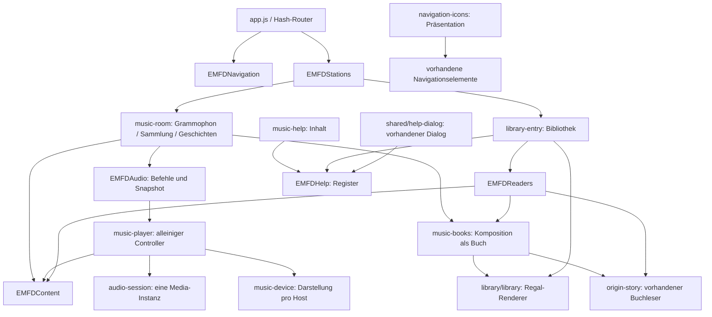

# Abhängigkeiten und Modulgrenzen nach ARCH-01

Der Wiedergebrauch des generischen `library/library.js` durch das Geschichtenregal ist erlaubt: Der Renderer besitzt nur den übergebenen Host. Es gibt keine Bibliothekssteuerung des Musikzimmer-DOM und keinen Musikzimmerzugriff auf `#emfd-library-root`. Der gemeinsame Leser ist ein eigener Dienst, keine Kommunikation zwischen Raumoberflächen.

## Eigentum und erlaubte Grenzen

| Eigentümer | Darf besitzen | Andere Module verwenden |
|---|---|---|
| `music-player.js` | Audiositzung, Wiedergabeabsicht, Playlist, Wiederholung, Stille | `EMFDAudio` Befehle/Snapshots; alte `EMFDMusic`-Aufrufe nur als Kompatibilität |
| `shared/content.js` | Unveränderliche, deduplizierte Laufzeitdaten | Lesende Zugriffe, keine Kopien der Geschichten als neue Quellen |
| `shared/navigation.js` | Route, Herkunft, Türkennzeichnung, Rückkehr und Wiederherstellung | `go`, `back`, `returnRoute`, `subscribe`, `ready` |
| `shared/stations.js` | Registrierung und Lebenszyklus der Renderer | Provider `render(host,options)` / `leave(host)` |
| Fachrenderer | Übergebener DOM-Bereich und eigene lokale Auswahl | Keine DOM-Suche in einer anderen Fachstation |
| `origin-story.js` | Leser-Dialog, Kapitel, Lesefokus | `EMFDReaders` bzw. bestehender `music-books`-Adapter |
| `shared/help.js` | Kontextbeschreibungen | Registrierung durch Fachmodule, Darstellung im bestehenden Hilfedialog |

Die sechs gemeinsamen Dienste heißen `EMFDNavigation`, `EMFDStations`, `EMFDAudio`, `EMFDContent`, `EMFDReaders`, `EMFDHelp`, jeweils mit `version:1`. Sie werden vor ihren Fachverbrauchern geladen. `shared/help-dialog.js` erweitert erst nach dem ursprünglichen Hilfehandler den vorhandenen Dialog.

## Bewusst verbleibende Kompatibilität

`music-room.js` enthält weiterhin drei Darstellungen; sie sind einzeln als `gramophone`, `records`, `compositions` registriert. Diese Provider können anschließend in getrennte Dateien umziehen. `EMFDMusicRoom` bleibt kompatibel, insbesondere für das Tutorial. Das Tutorial nutzt weiterhin den Geräte-/Audioadapter.

`EMFDMusic.bindRoom`, `EMFDMusicDevice.sync` und der Legacy-Getter `EMFDMusic.session` bleiben erhalten. Die Gerätedarstellung erhält bereits einen schreibgeschützten Snapshot. Die noch vorhandene DOM-Bindung des zentralen Controllers ist eine dokumentierte Übergangsgrenze; neue Fachmodule sollen nicht direkt `session.audio` verändern. Die bestehende Karten-/Teezimmer-Logik wurde nicht neu geschrieben.
