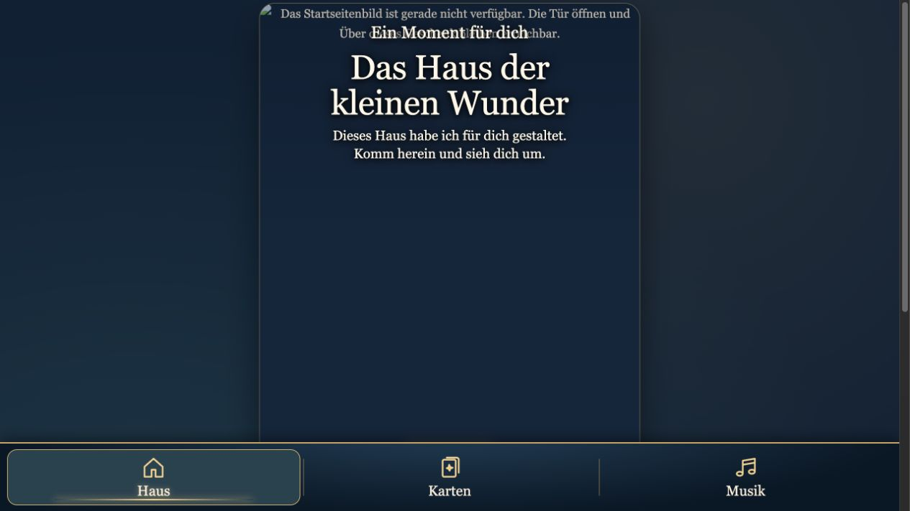
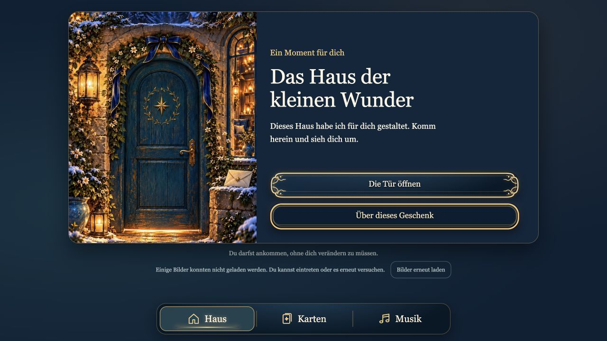
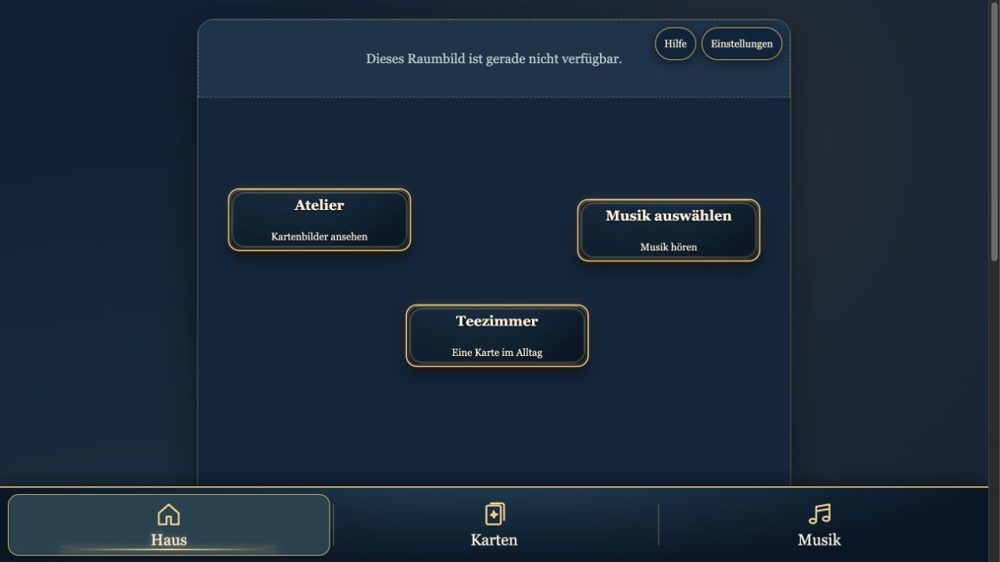
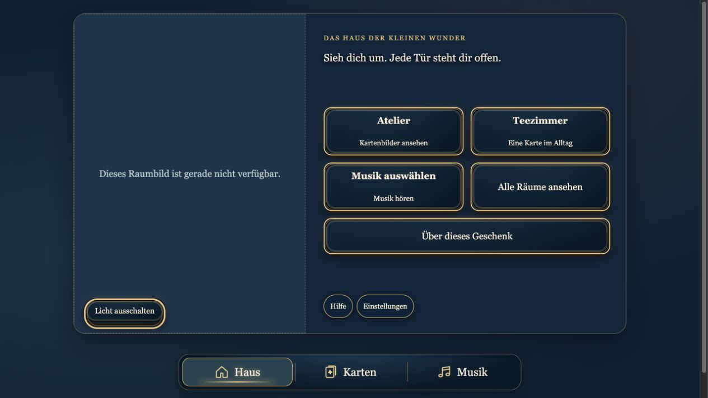
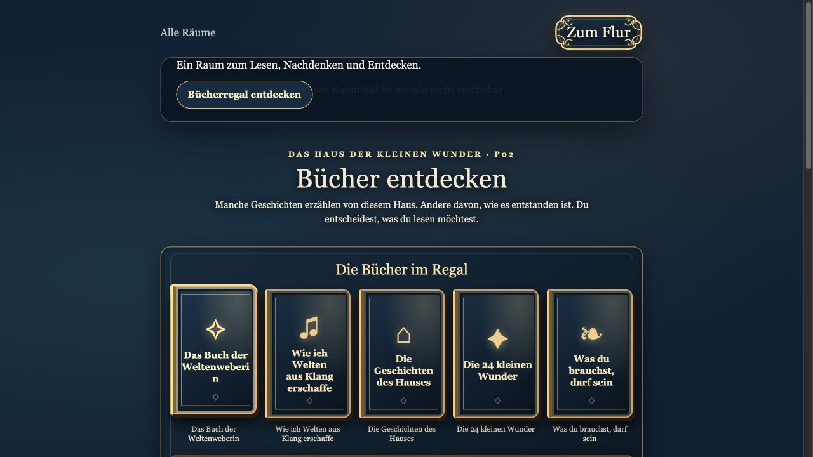
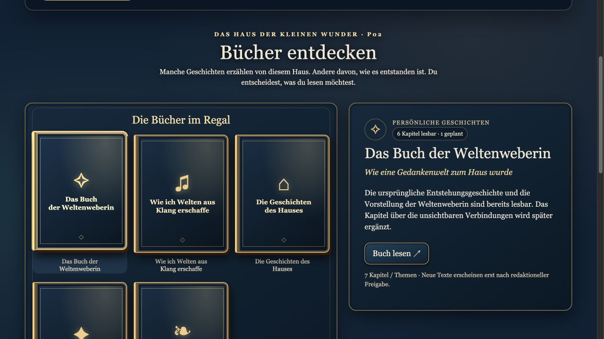
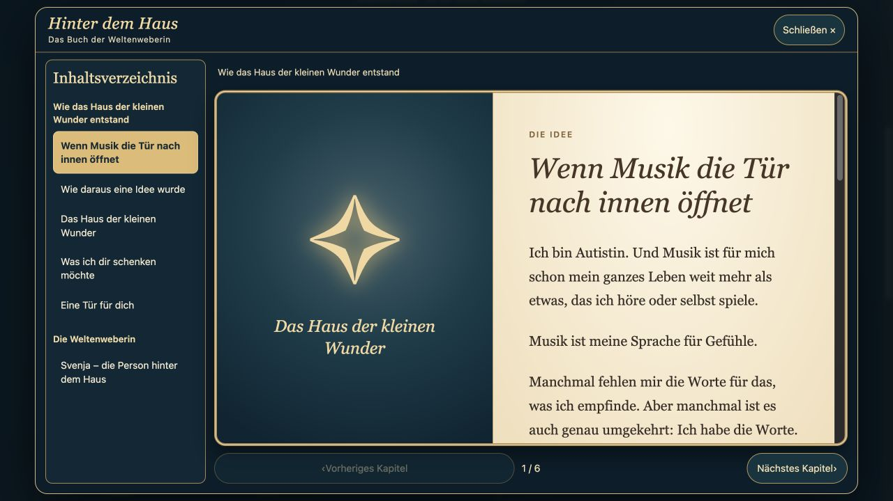
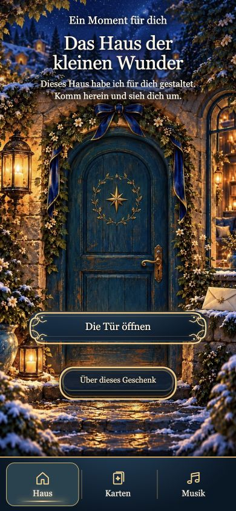

# Desktopprüfung und Korrekturen · 5. November 2026

Basis: EMFD v0.6.60. Lokale Desktopkorrektur, noch nicht auf dem Webserver veröffentlicht.

## Geprüfte Schritte

1. **Eingang – korrigiert.** Die 9:16-Szene war auf dem Desktop länger als der sichtbare Bereich. Der Geschenkbutton erbte gleichzeitig top und bottom aus verschiedenen CSS-Dateien. Er wurde dadurch zu einer 323 Pixel hohen unsichtbaren Klickfläche und überdeckte den Türbutton. Der Fehler wurde durch einen echten Klick reproduziert: Statt des Flurs öffnete sich das Buch. Jetzt stehen Text und Buttons neben dem Bild im normalen Layoutfluss. Beide Buttons wurden einzeln erfolgreich betätigt. Das mitgelieferte Türbild wird als Ersatz geladen, wenn die optimierte externe Datei fehlt.

2. **Flur und Raumübersicht – korrigiert / Navigation geprüft.** Die Flurszene war ebenfalls viel zu hoch, untere Wege lagen außerhalb des Bildschirms. Am Desktop stehen die Raumwege jetzt rechts neben der Szene in einem Raster. Hilfe, Einstellungen und Lichtschalter bleiben erreichbar. Alle acht Flurkontrollen wurden am Laptopformat auf sichtbare, unverdeckte Klickmittelpunkte geprüft. Der Weg Alle Räume → P02 Bibliothek wurde erfolgreich durchlaufen. Die fehlenden Raumbilder verhindern die Beurteilung ihrer endgültigen Bildwirkung.

3. **Bibliothek – korrigiert.** Der eingebettete Raum war auf 760 Pixel begrenzt, fünf Buchcover wurden in eine enge Reihe gedrückt, darunter stand erst die Beschreibung. Die neue Desktopansicht nutzt bis zu 1160 Pixel mit drei Büchern pro Reihe und einer Beschreibung daneben. Der Umbruch einzelner Buchstaben ist entfernt. Ein fehlendes Raumbild lässt den Titel nicht mehr mit der Fehlermeldung kollidieren. Bücherregal entdecken führt zum Regal.

4. **Lesen und Rückkehr – funktionsfähig.** Buch lesen öffnet die bestehende Weltenweberin-Lektüre mit sechs Kapiteln. Schließen kehrt zur Bibliothek zurück. Über dieses Geschenk öffnet weiterhin die allgemeine Hintergrundgeschichte. Die Leseansicht selbst wurde nicht neu gestaltet.

5. **Handyansicht – Stichprobe bestanden.** Bei 390 × 844 Pixeln bleiben Tür- und Geschenkbutton sichtbar und erhalten ihre eigenen Klicks. Die Tür führt in den Flur. Der Geschenkbutton erhielt einen deckenden dunklen Hintergrund für lesbare Schrift. Außerdem wurde der Desktopflur bei 1366 × 768 Pixeln geprüft; Hauptprüfung im vorhandenen Browserfenster von ca. 1265 × 712 Pixeln.

## Änderungen

- Neue desktop-layout.css, eingebunden in index.html. Desktopregeln ab 900 Pixel Breite, kompakte Szenen zwischen 701 und 899 Pixeln.
- start-gate.js: Ersatz durch das bereits mitgelieferte assets/rooms/startseite-haustuer-v1.webp, falls die optimierte Startdatei fehlt.
- Keine neuen Raumillustrationen und keine Änderungen an den Buchtexten oder Audiodateien.

## Grenzen und Tests

Das übergebene ZIP enthält home/, aber nicht das erwartete gemeinsame media/-Verzeichnis. Deshalb sind Raum- und Kartenbilder sowie echte Musikwiedergabe hier nicht vollständig prüfbar. Die Warnung zu fehlenden Bildern bleibt bewusst sichtbar. Eine Prüfung der veröffentlichten PC-Seite wurde nicht durchgeführt, da keine URL angegeben war.

Die bestehende Testsammlung wurde sowohl unverändert als auch nach den Korrekturen ausgeführt: vorher 151 bestanden, 23 fehlgeschlagen, 1 übersprungen; nachher 152 bestanden, 22 fehlgeschlagen, 1 übersprungen. Keine zusätzlich fehlgeschlagenen Testfälle. Vorbestehende Fehler betreffen unter anderem fehlende Medien und veraltete Versions-/Strukturerwartungen; die Tests sind deshalb insgesamt nicht grün.

Sichtbare Fokusmarkierungen und beschriftete Bedienelemente sind vorhanden. Die überdeckten Klickflächen wurden behoben. Dies ist keine vollständige Prüfung der Barrierefreiheit: Screenreader, komplette Tastaturwege und Kontrastmessungen aller Ansichten stehen noch aus.

Die beigefügte lokale ZIP ist eine überarbeitete Arbeitsfassung; die verknüpfte Library-Datei konnte mit den verfügbaren Werkzeugen nicht direkt ersetzt werden.
