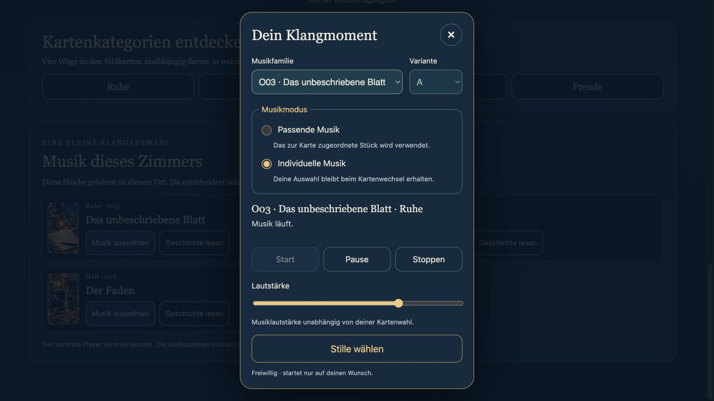
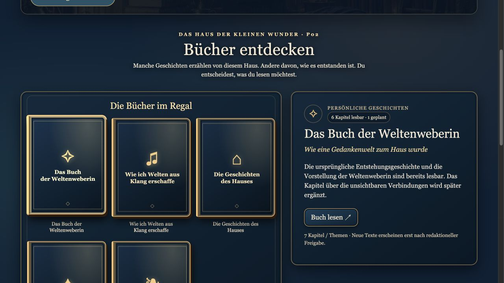

# Musik und Bibliothek · 5. November 2026

## Ergebnis

Die komplette Bibliothek aus der erneut angegebenen Downloads-ZIP ist in dieser Arbeitsfassung enthalten. Alle Dateien unter home/library/ wurden bytegenau mit dieser ZIP verglichen und sind identisch. Die bereits vorgenommenen Desktopkorrekturen bleiben zusätzlich aktiv, ebenso der Ersatz für das Eingangsbild.

## Ursachen und Korrekturen

1. Auf der veröffentlichten Playlist waren sämtliche 25 Auswahlbuttons dauerhaft deaktiviert und ohne Verbindung zum Player. Sie wählen nun den Titel im zentralen Player aus. Die Wiedergabe erfolgt anschließend über Start.
2. Start setzt eine vorherige bewusste Pause zurück. Karten können nach einem erneuten Start wieder passend begleitet werden. Individuelle Musikauswahl wird beim Aufdecken respektiert.
3. Wechsel vom Kartenbild in einen normalen Raum stoppt passende Musik nicht mehr wegen einer leeren Karten-ID. Rückkehr ins Teezimmer, verdeckte Karten und bewusste Stille behalten ihre bisherigen Stopregeln.
4. Ein und dasselbe Audioelement wird wiederverwendet. Verspätete Antworten alter Wiedergabeversuche können ein neues Stück nicht mehr pausieren. Alte Ereignisbehandler werden entfernt.
5. Der Tonbutton zeigt den tatsächlichen Start-/Wiedergabezustand an. Nach einem Fehler lässt sich mit einem Klick erneut starten. Bei fehlender Auswahl wird die aktuelle Kartenmusik vorbereitet.
6. Wiedergabefehler werden auch bei geschlossenem Player sichtbar, mit Schaltflächen zum Öffnen des Players und Schließen des Hinweises.

## Serverbefund

Alle 24 Kartenpfade und THEME.mp3 wurden am 5. November 2026 direkt auf https://flowisaurus.de/wunderhaus/media/audio/ per HTTP HEAD geprüft. 15 Kartensongs und THEME.mp3 liefern HTTP 200 und audio/mpeg. Neun erwartete Dateien liefern HTTP 404:

- O02.mp3
- O04.mp3
- O05.mp3
- O06.mp3
- O07.mp3
- O09.mp3
- O10.mp3
- O12.mp3
- O16.mp3

Diese Dateien müssen auf dem Server unter den erwarteten Namen bereitgestellt werden, oder ihre tatsächlich vorhandenen Pfade müssen im Musikmanifest eingetragen werden. Es wurden keine Ersatzsongs erfunden und keine Originale umbenannt. Die HTTP-Prüfung der übrigen Dateien ersetzt keinen vollständigen Hörtest. Maschinenlesbarer Befund: audio-live-files.json.

## Browserprüfung

Die korrigierte lokale Fassung wurde mit den echten Medien der Website getestet. Ein ausschließlich lokaler Vorschau-Server leitete Medienanfragen an die vorhandenen Serverdateien weiter. Diese Testweiterleitung ist nicht Bestandteil der ausgelieferten Anwendung; sie behält ihre relativen Pfade.

- O01: Playlistauswahl → Start → Musik läuft; Pause → Fortsetzen; Stoppen → Start erfolgreich.
- O01: Direkter Tonbutton der Bildkarte startet und stoppt das Stück erfolgreich.
- THEME: Auswahl und Start erfolgreich.
- O02: Auswählen und Wiederholen liefern einen sichtbaren Fehler; der entsprechende Serverpfad liefert 404.
- O03: Musikauswahl direkt aus der Bibliothek → Start → Musik läuft.
- Bibliothek: Regal mit fünf Büchern, verbreiterter Desktopansicht und zugehöriger Beschreibung vorhanden.

## Automatische Prüfungen

15 gezielte Verhaltenstests für Audiositzung und Player bestanden. Die gesamte bestehende Sammlung umfasst jetzt 180 Tests: 157 bestanden, 22 bereits vorher fehlgeschlagen, 1 übersprungen. Keine zusätzlichen Fehlschläge. Vorbestehende Fehler betreffen unter anderem fehlende lokale Medien und veraltete Erwartungen der bisherigen Tests. Vollständige Safari-/iOS-Prüfung und Prüfung aller Songverläufe stehen aus.

## Bereitstellung

Das ZIP enthält home/ vollständig einschließlich Bibliothek, Layoutkorrekturen und Musikänderungen. home/ ist in den vorhandenen Ordner /wunderhaus/home/ zu übernehmen; das vorhandene /wunderhaus/media/ bleibt separat erhalten. Danach die Seite neu laden. Die geänderten Musikskripte haben neue Cachekennungen. Eine Veröffentlichung oder Änderung am Webserver wurde nicht durchgeführt.

Die Library-Verknüpfung der ursprünglichen Anlage wurde mangels passendem Werkzeug nicht ersetzt; dies ist ein lokaler Download.
