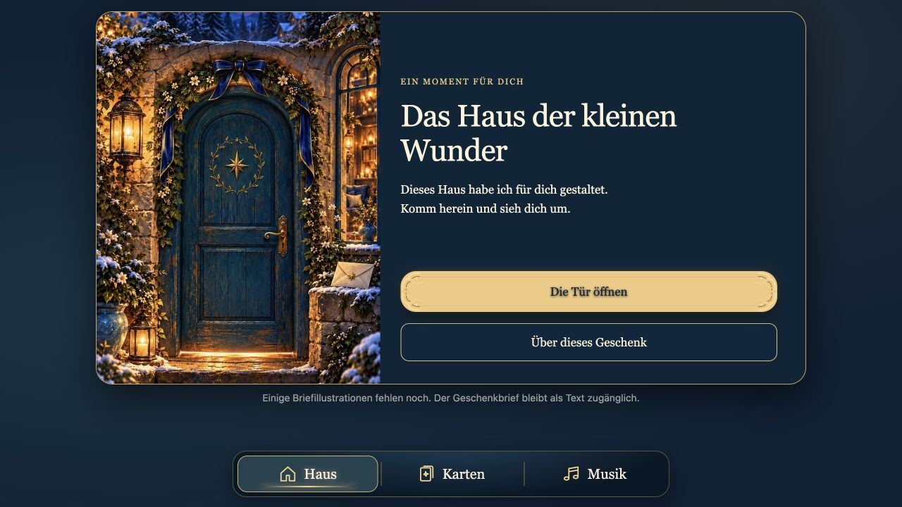
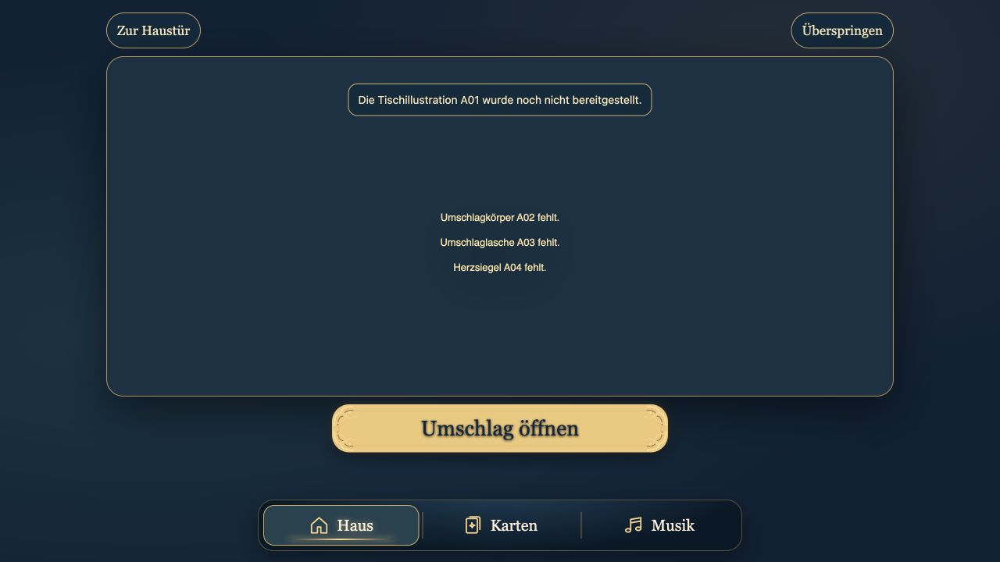
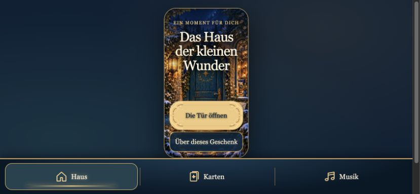
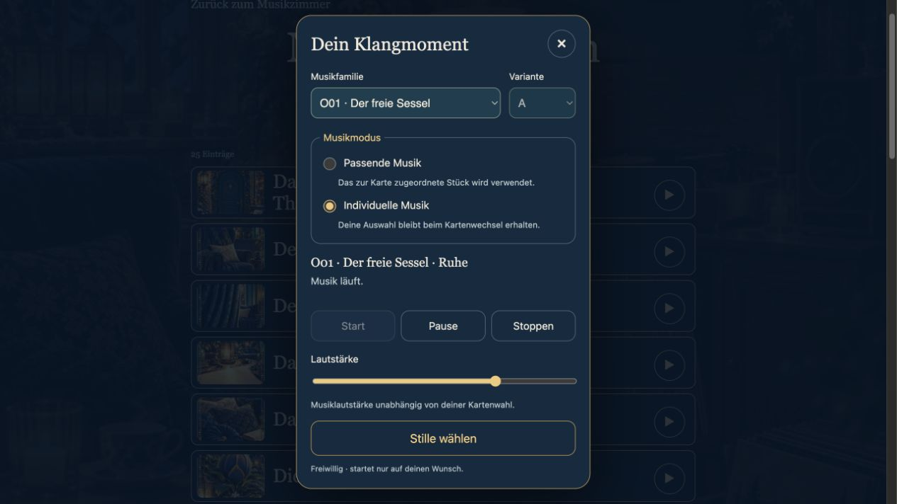

# v0.6.61 · START-02 + Desktop + Musik

Stand: 5. November 2026. Zusammengeführte Arbeitsfassung, nicht veröffentlicht.

## Herkunft

Die Eingangsanlage aus Downloads hat den angegebenen SHA-256 dbbfec1d94a024374880eaa467210a270e607efa00f631215a31f299a88c2407. START-02 wurde als Basis verwendet. Die Basisversion 0.6.61 bleibt konsistent in Paket, HTML, PWA-Manifest und Deploymentbeschreibung. Die kombinierte Ausgabe trägt im Dateinamen den Zusatz START02-DESKTOP-MUSIK.

## Zusammenführung

- START-02 übernimmt den gesamten neuen Einstieg: fünf Zustände, Erst-/Folgebesuch, Briefwiederholung, Einführung, freiwillige Installationshilfe und gespeichertes Licht. Seine Logikdateien wurden unverändert übernommen.
- Unsere drei korrigierten Musikdateien wurden unverändert erhalten: funktionierende Playlistauswahl, erneuter Start nach Pause/Stoppen, ein wiederverwendetes Audioelement, keine Unterbrechung durch leere Karten-ID sowie sichtbare, schließbare Fehlerhinweise.
- Die vollständige Bibliothek und die Funktionen für Teezimmer, Atelier, Karten, Hintergrundgeschichte und Gedankenblatt entsprechen der START-02-Anlage. Die betroffenen Dateien wurden bytegenau auf Erhalt geprüft.
- Desktoplayout für Flur und Bibliothek bleibt aktiv. Der neue Eingang erhielt dieselbe Aufteilung mit Bild links und Text/Buttons rechts. Handy-Hochformat und Querformat behalten ihre eigenen Darstellungen.
- Zusätzliche Integrationskorrekturen: Brief-Fallbacktexte A02–A04 stehen getrennt; der Umschlagbutton bleibt oberhalb der festen Navigation; der Briefkicker hat eine dunkle Schrift auf hellem Papier.
- Die HTML-Einbindungen der Musikskripte und des kombinierten Layouts haben eigene Cachekennungen. Es wurde keine zweite Audioarchitektur eingeführt.

## Prüfung

Die unveränderte START-02-Anlage und die zusammengeführte Version wurden mit derselben Node-Laufzeit geprüft. Zusammengeführt: **188 Tests, 170 PASS, 17 bekannte FAIL, 1 SKIP**. Keine neuen fehlgeschlagenen Testfälle gegenüber der Eingangsanlage. Alle acht START-02-Tests und alle 15 Audio-Verhaltenstests bestehen. Die bekannten Fehler der Gesamtsuite bleiben im ursprünglichen START-02-Testbericht dokumentiert.

Browserprüfung der zusammengeführten Fassung:

1. Desktop-Haustür: Bild/Text nebeneinander, Buttons sichtbar und getrennt bedienbar.
2. Erstbesuch: closed → opening → letter-visible → gift-card-visible → completed → Flur durchlaufen.
3. Einführung übersprungen, freiwillige Installationshilfe mit Später geschlossen.
4. Über dieses Geschenk im Flur öffnet erneut den Brief.
5. Folgebesuch führt über die Tür direkt in den Flur.
6. Licht ausgeschaltet, Seite neu geladen: Zustand bleibt ausgeschaltet.
7. Handy 390 × 844: Tür und wiedergeöffneter Brief visuell geprüft.
8. Querformat 844 × 390: Tür und beide Buttons sichtbar.
9. Playlist → O01 → Start: echte Servermusik spielt erfolgreich; anschließend bewusst gestoppt.
10. Keine JavaScript-Fehlermeldungen im Browserprotokoll.

Die lokale Prüfvorschau verwendet die vorhandenen Medien von flowisaurus.de über einen separaten Testserver. Diese Weiterleitung gehört nicht zur Anwendung. Die Ausgabe nutzt weiter relative Medienpfade. Eine vollständige Prüfung auf echten Mobilgeräten oder eine PWA-Installation wurde nicht durchgeführt.

## Offen

A01–A06 fehlen weiterhin. Es wurden keine Produktionsbilder erfunden. Die neun zuletzt festgestellten fehlenden Kartensongs bleiben ein separater Serverpunkt: O02, O04, O05, O06, O07, O09, O10, O12 und O16 als MP3. Der letzte HTTP-Befund liegt in audio-live-files.json. Diese Musikdateien wurden bei der Zusammenführung nicht erneut hochgeladen oder ersetzt.

## Installation

Das ZIP enthält home/ vollständig. Den Inhalt am bestehenden Ziel /wunderhaus/home/ übernehmen und das gemeinsame /wunderhaus/media/ erhalten. Die vorliegende Arbeit hat keine Dateien auf der veröffentlichten Website geändert. file-hashes.json enthält die neu berechneten Prüfsummen aller mitgelieferten Dateien außer sich selbst.

Die älteren Desktop- und Musikberichte sind als Vorgeschichte enthalten; für diese kombinierte Version gilt dieser Bericht.
